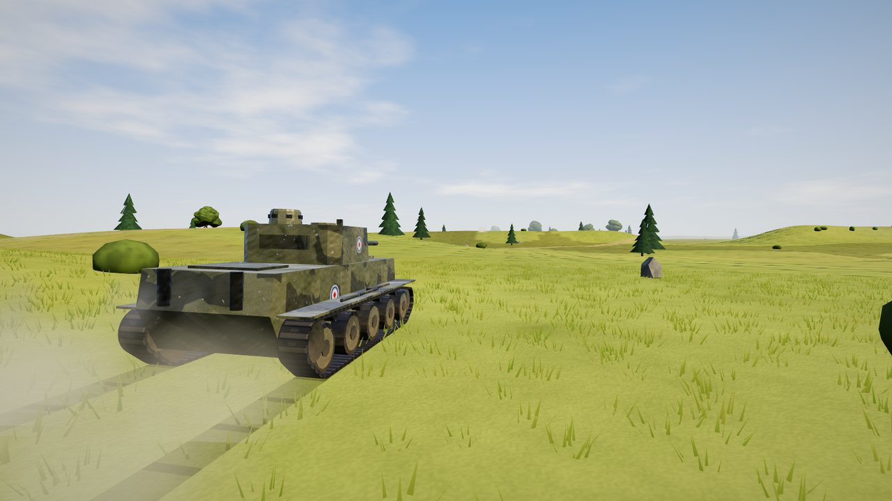
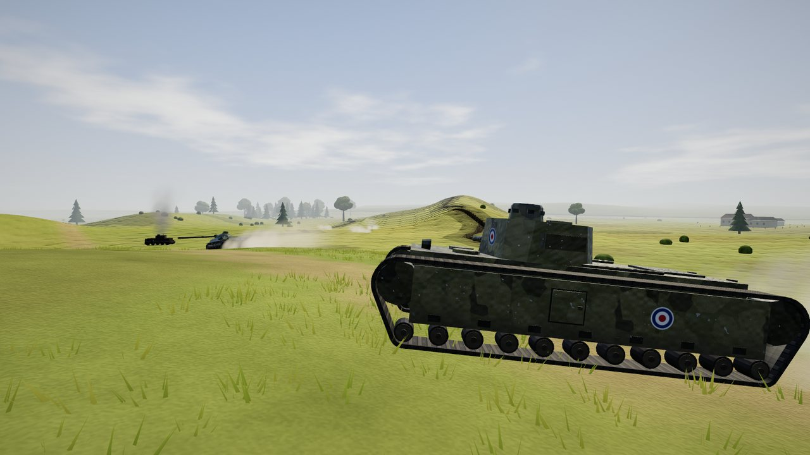
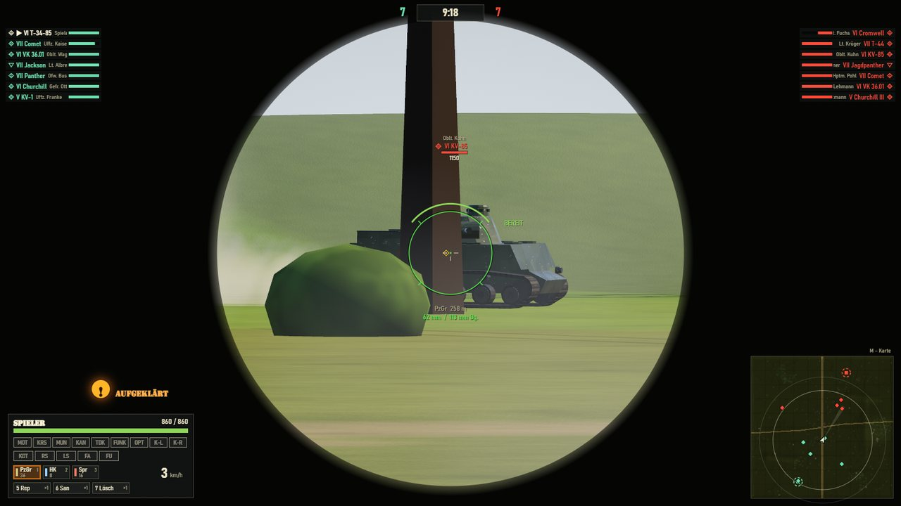
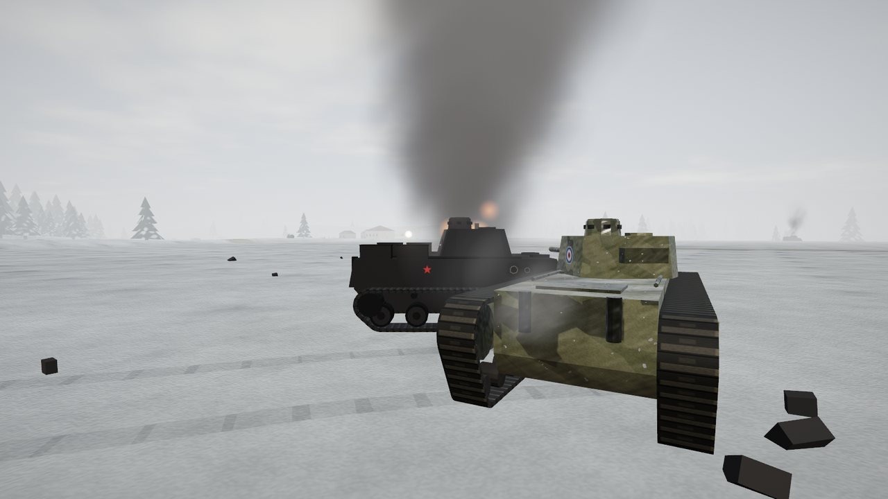
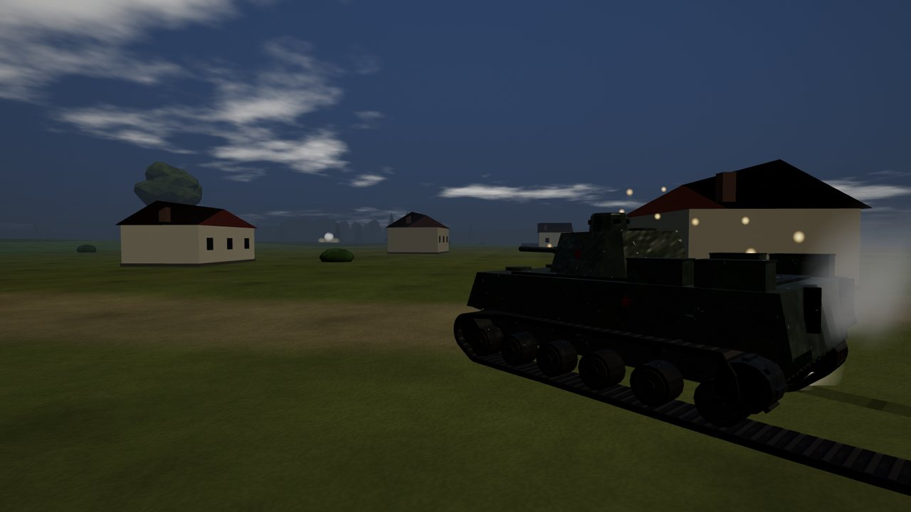
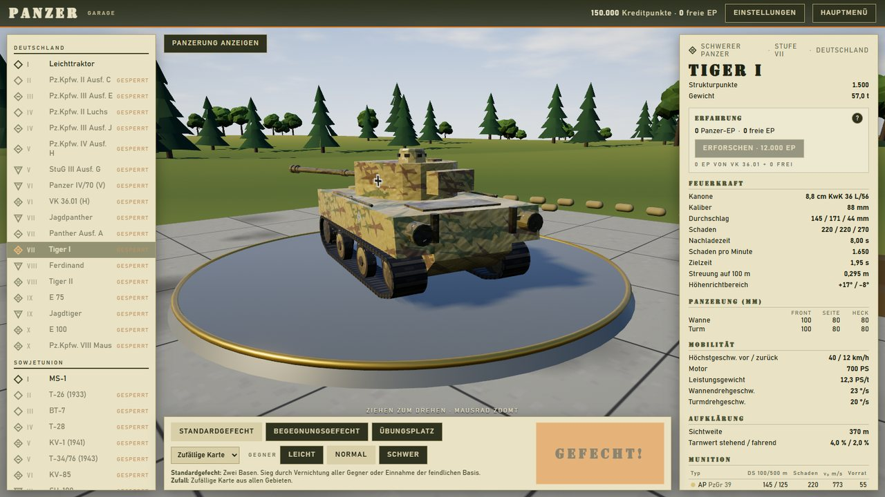
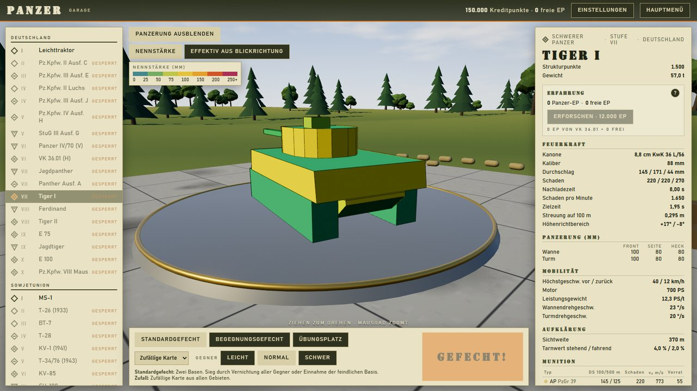
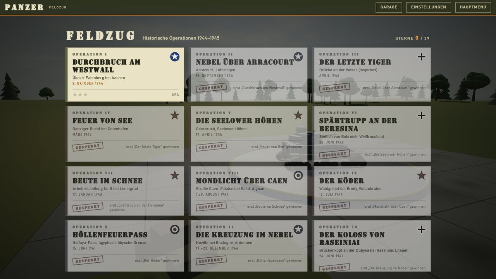
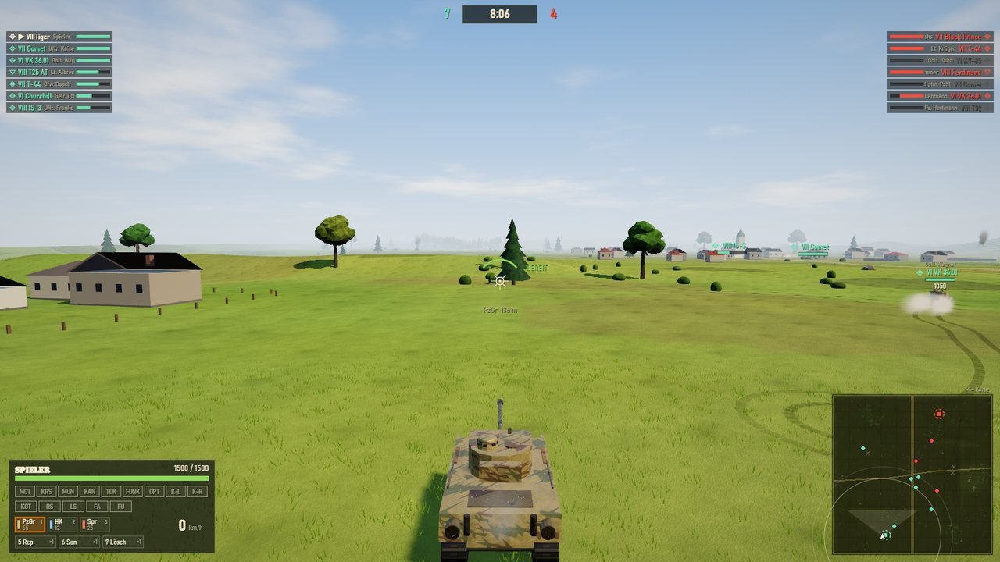

# Panzer (wartanks)

Browser-Panzerspiel im Zweiten Weltkrieg: Panzerungsdicke und Auftreffwinkel, Munition und Ballistik, Fahrkönnen. three.js, kein Build-Schritt, serverloser Multiplayer.

**Spielen:** https://deralo.github.io/wartanks/

| | |
|---|---|
|  |  |
| **Kursker Bogen**: Steppe, Staub und ein Grabensystem quer übers Feld | **Visier**: Durchschlag hängt an Dicke, Winkel, Munition und Entfernung |
|  |  |
| **Ardennen**: eisiger Nebel, man sieht den Gegner erst spät | **Nacht bei Caen**: Mondlicht, Mündungsfeuer verrät die Stellung |
|  |  |
| **Garage**: 75 Panzer in Forschungsbäumen, Stufe I bis X | **Panzerungsansicht**: Nenn- und effektive Dicke aus Blickrichtung |
|  |  |
| **Feldzug**: 13 historische Operationen 1941–1945 | **Gefecht**: 7 gegen 7, Standard- oder Begegnungsgefecht auf 11 Karten |

## Starten

`npm start` -> http://localhost:5173/

Tests: `npm test`. Aufbau und Schnittstellen: siehe [ARCHITECTURE.md](ARCHITECTURE.md).
